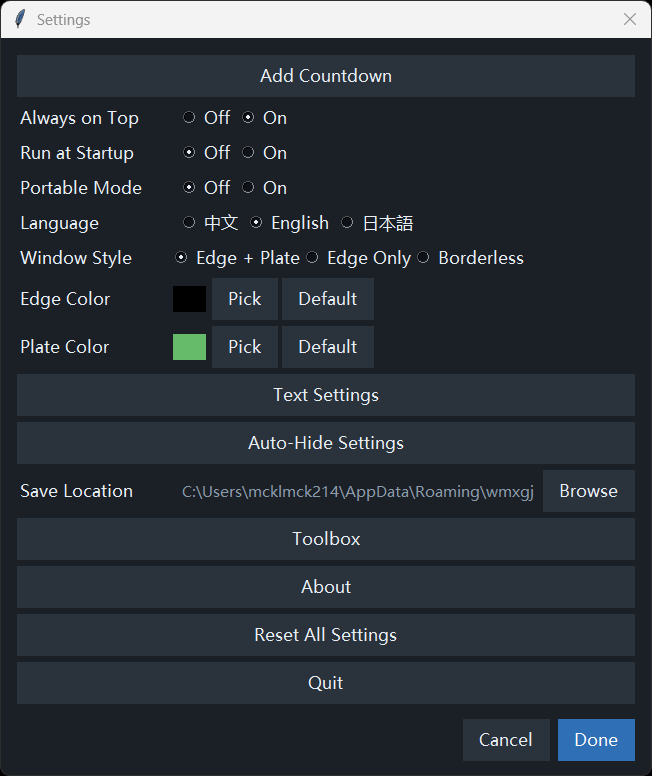
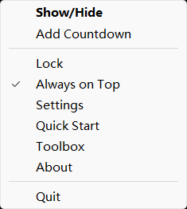
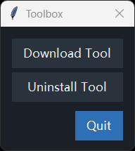
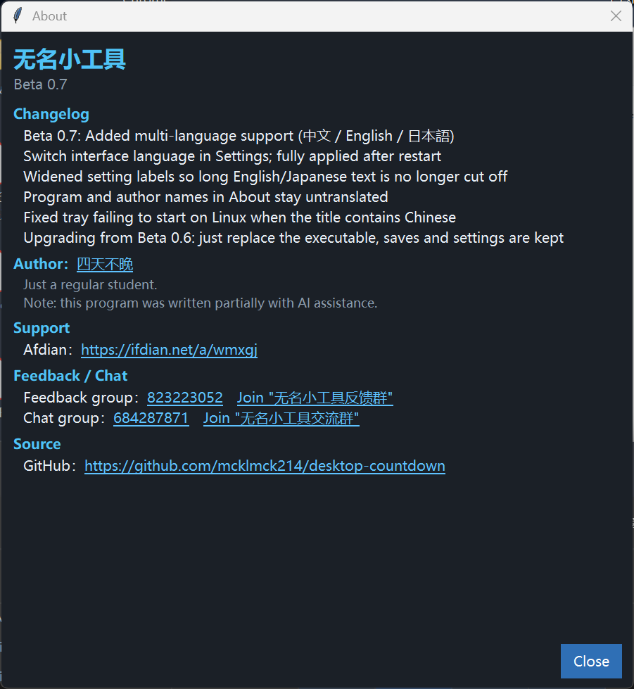
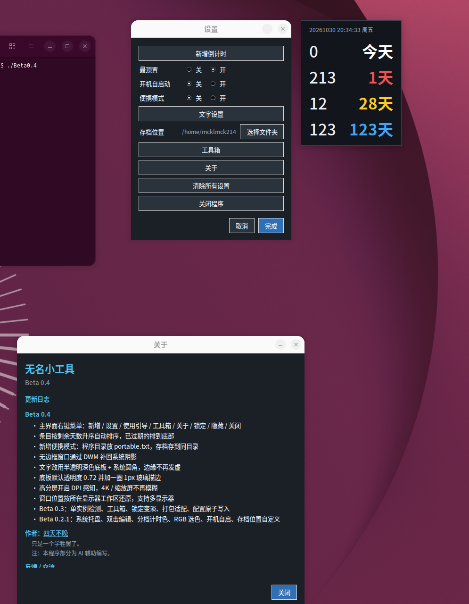
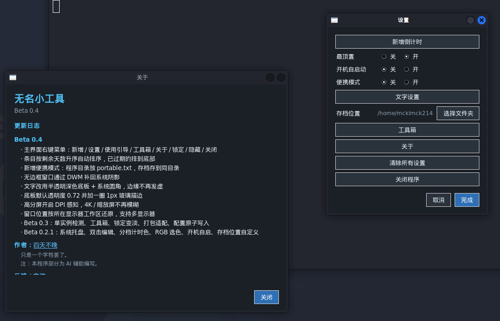
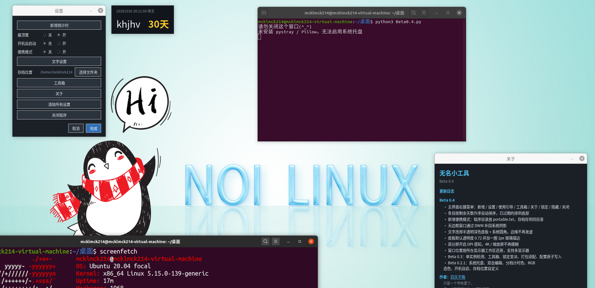

# Desktop Countdown

[](https://github.com/mcklmck214/desktop-countdown/releases)
[](#system-compatibility)
[](LICENSE)
[](https://space.bilibili.com/2061499488)
[](https://ifdian.net/a/wmxgj)

**Languages:** [简体中文](README.md) | **English** | [日本語](README.ja.md)

A transparent countdown widget that stays in the corner of your desktop: a frameless little window that keeps an eye on multiple “days left” at once.

> Current version: **Beta 0.7**

## Features

- **Two timing modes**
  - `n days later`: rolls over automatically every day, ideal for recurring goals such as “keep a streak”
  - `specific date`: counts down to a fixed date; expired items can be removed in one click
- **Automatic sorting**: items are sorted by remaining days in ascending order, expired ones sink to the bottom
- **Tiered colors**: today / within 3 days / within 7 days / within 30 days / within 365 days / within 1000 days, each with its own color, customizable
- **Frameless floating window**: translucent dark plate + system shadow + Windows 11 rounded corners; draggable and lockable
- **System tray**: show/hide, lock, settings, guide, toolbox, about
- **Right-click menu**: add, settings, lock and hide directly from the main window
- **Double-click to edit**: change name, time and color of an item
- **Portable mode**: place a `portable.txt` next to the executable and saves go to the program folder instead of your home directory
- **Toolbox**: launch `Plain Craft Launcher 2.exe` and `geek.exe` from the same folder (the latter auto-elevates via UAC)
- **Single instance**: a second launch shows a notice and exits, so two windows never fight over the same save file
- **HiDPI friendly**: DPI aware; window position is restored per monitor work area on multi-monitor setups

## Screenshots

### Main window

Six tiers of remaining days are color-coded automatically; items are sorted by days and expired ones sink to the bottom.


### Settings

Always on top, run at startup, portable mode, text color and size, save location, toolbox, about.



### Context menu

Left-click the tray icon to show/hide the main window; right-click opens the full menu.



### Toolbox

Launch the download tool (Plain Craft Launcher) and the uninstall tool (Geek Uninstaller) in one click; the latter auto-elevates via UAC.



### About

Built-in changelog, author and feedback entry points.



### Languages

Chinese / English / Japanese are supported. Switch under “Settings → Language”; the change is fully applied after restarting the app.

### Linux

Ubuntu 24.04 (packaged build, six-tier colors / settings / about):



Kali Linux (packaged build, Xfce desktop, settings and about):



NOI Linux (Ubuntu 20.04 kernel; source run only with `python3 wmxgj_Beta0_7.py`):



On Linux there is no `-transparentcolor` keying; the window is shown with a translucent dark plate. Packaged builds come in two variants: **full** (about 123 MB) bundles GTK tray dependencies and works via `libayatana-appindicator`; **lite** (about 22 MB) drops GTK and uses the XEmbed backend, which cannot handle non-Latin tray titles, so the tray fails to start and the app falls back to keyboard shortcuts while everything else keeps working. Running from source requires `pip install pystray pillow`; if missing, the app reports “system tray unavailable” and everything else works normally.

## System compatibility

| System | Status |
| --- | --- |
| Windows 11 | Verified; supports system rounded corners and DWM shadow |
| Windows 10 | Verified |
| Windows 8.1 | Verified |
| Windows 7 / Vista | Windows 7 verified with Beta 0.7 (Python 3.8 build, 64-bit); Vista untested |
| Kali Linux | Verified; both full and lite packaged builds run |
| Ubuntu 24.04 | Verified with the packaged build |
| NOI Linux (Ubuntu 20.04) | Source only: the packaged build needs a newer glibc, use `python3 wmxgj_Beta0_7.py` |

## Download

| Channel | Link | Code |
| --- | --- | --- |
| GitHub Releases (recommended) | <https://github.com/mcklmck214/desktop-countdown/releases> | none |
| Lanzou Cloud | <https://wwbjl.lanzout.com/b01i5ystif> | `stbw` |
| EdgeCOS | <https://user.edgecos.com/s/NCxRhxJx> | none |
| 123 Pan | <https://1845990486.share.123pan.cn/123pan/APOqTd-sZLFh> | none |
| Quark Pan | <https://pan.quark.cn/s/a979bc4c2900?pwd=nbM1> | `nbM1` |
| Baidu Pan | <https://pan.baidu.com/s/1vuZrvnPnc2VFf7GtPIIeGQ?pwd=stbw> | `stbw` |

## Run

```bash
pip install pystray pillow
python wmxgj_Beta0_7.py
```

- Requires `tkinter` (standard library), `pystray`, `Pillow` (tray icon; if missing, the app falls back to keyboard shortcuts)
- No taskbar icon appears after launch; everything starts from the **system tray**. If the tray is not visible, press `Ctrl+Shift+L` to toggle lock
- Linux packaged builds: Releases provides **full** (with GTK tray dependencies, about 123 MB) and **lite** (tray unavailable, automatic fallback, about 22 MB); `chmod +x` and run directly (verified on Kali / Ubuntu 24.04)

## Project layout

```
wmxgj_Beta0_7.py  Main program: window, menus, dialogs, tray, single instance
utils.py          Utilities: paths, dates, DPI, DWM shadow/rounded corners, multi-monitor work area, autostart
storage.py        Config I/O: save location, atomic writes, portable mode
lang.json         UI translations (zh / en / ja)
image.png         Tray icon
OLD_FILES/        Historical sources and builds (archive only, not used at runtime)
```

## Save location

- Default: `%USERPROFILE%\.desktop_countdown.json` (config), `~/.desktop_countdown_dir.json` records a custom save directory
- Portable mode: when `portable.txt` exists next to the executable, the config is written to the program folder
- All writes use “temp file + atomic replace”, so an abnormal exit never corrupts the save

## Version history

| Version | Highlights |
| --- | --- |
| Beta 0.7 | Multi-language UI (zh / en / ja), language switch in settings, expanded changelog, Linux tray title fallback |
| Beta 0.6 | Auto-hide by app list, list management in settings, Win7-compatible packaging |
| Beta 0.5 | GitHub link on the About page, Linux full/lite builds |
| Beta 0.4 | Right-click menu, auto sorting, split utils/storage, portable mode, DPI awareness, multi-monitor, DWM shadow and rounded corners, dark translucent plate |
| Beta 0.3 | Single instance, toolbox, dimmed lock, frozen-path support, atomic config writes |
| Beta 0.2.1 | System tray, double-click editing, tiered colors, RGB color picker, autostart, custom save location |
| Beta 0.1 / Alpha 0.0.1 | Initial release: transparent window, add/edit countdowns, tiered colors |

## Author

- Bilibili: <https://space.bilibili.com/2061499488>
- Email: <mcklmck214@outlook.com>
- Afdian: <https://ifdian.net/a/wmxgj>

## Feedback (QQ groups)

| Group | Number | Join link |
| --- | --- | --- |
| Feedback group | 823223052 | <https://qm.qq.com/q/livvSfQFfG> |
| Chat group | 684287871 | <https://qm.qq.com/q/1Q95hMYAxG> |

> Note: parts of this project were written with AI assistance.
