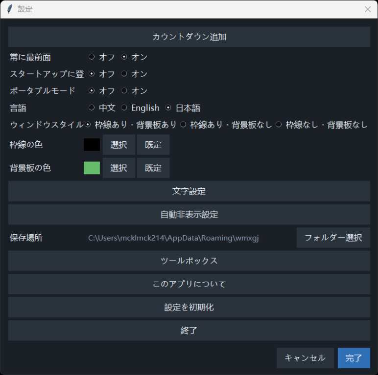
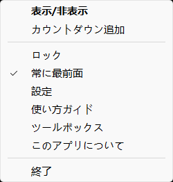
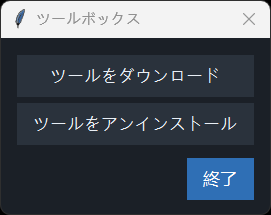
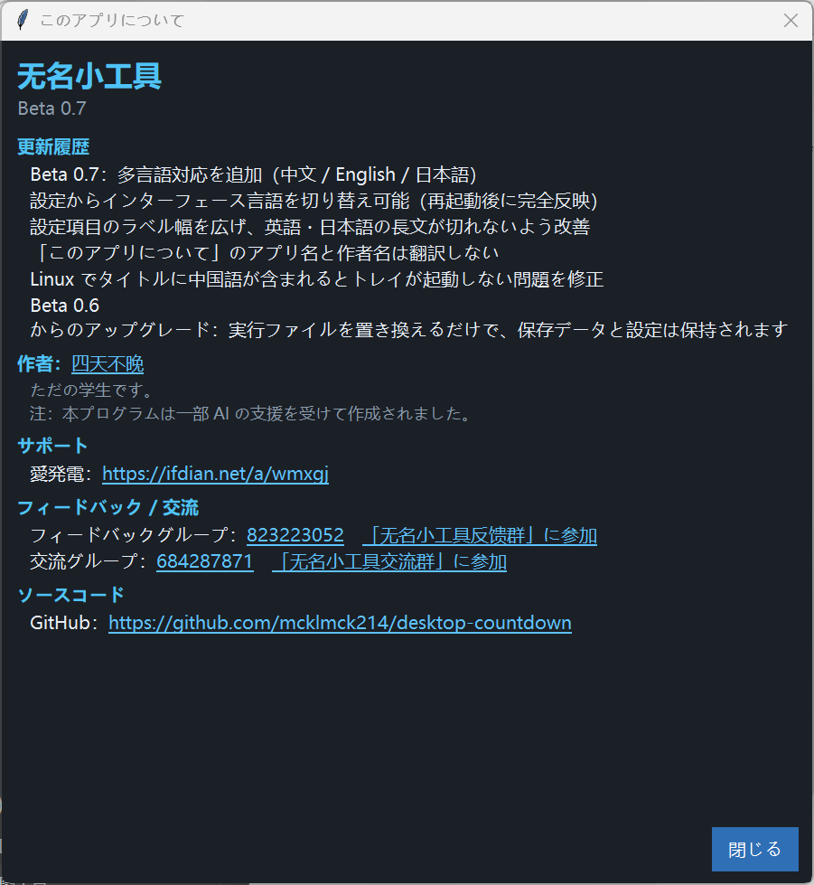
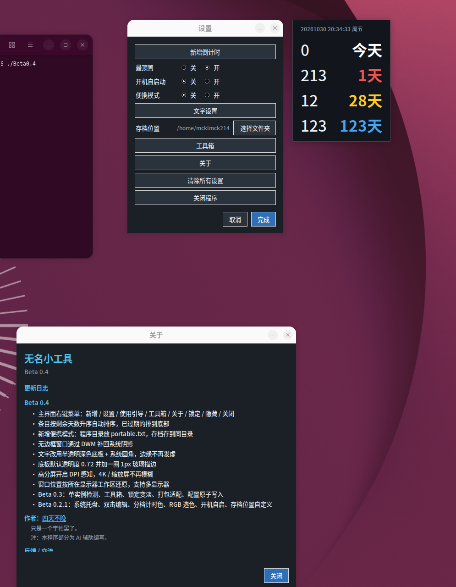
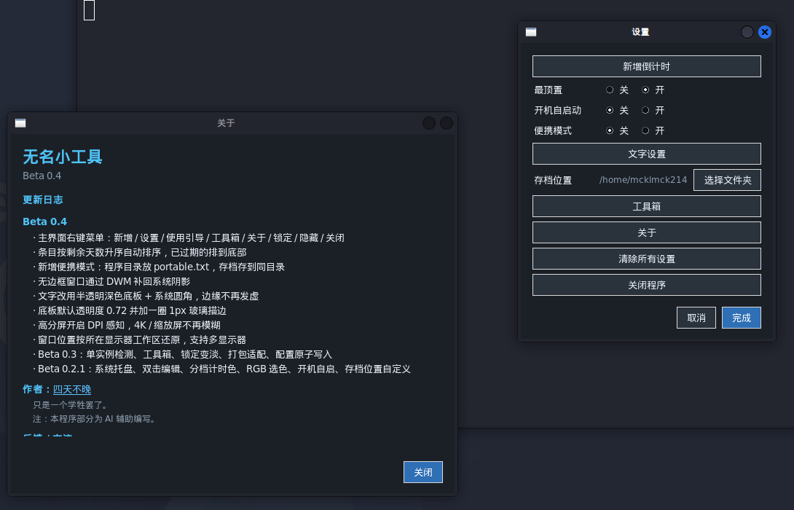
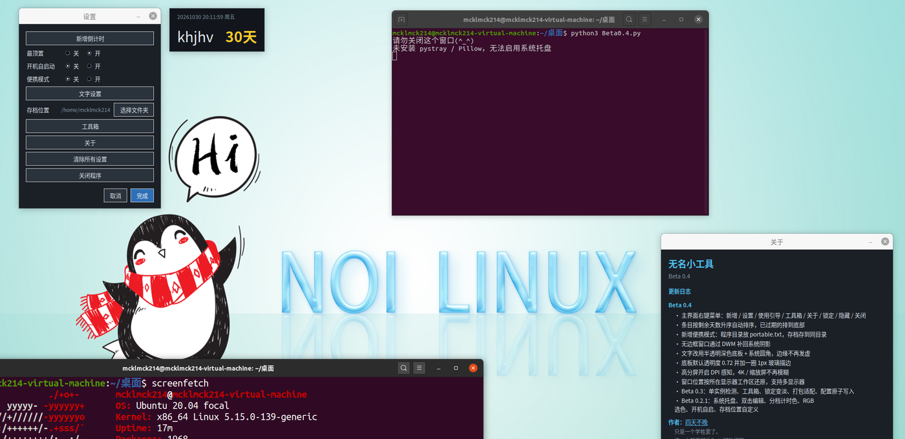

# 名無しウィジェット（Desktop Countdown）

[](https://github.com/mcklmck214/desktop-countdown/releases)
[](#システム互換性)
[](LICENSE)
[](https://space.bilibili.com/2061499488)
[](https://ifdian.net/a/wmxgj)

**言語:** [简体中文](README.md) | [English](README.en.md) | **日本語**

デスクトップの隅に常駐する透明なカウントダウンウィジェット。枠なしの小さなウィンドウで、複数の「あと何日」を同時に見守ります。

> 現在のバージョン：**Beta 0.7**

## 機能

- **2 つのカウント方式**
  - `n 日後`：毎日自動で繰り越されるため、「連続記録」のようなローリング目標に最適
  - `指定日`：決まった日までカウントダウン。期限切れはワンクリックで削除可能
- **自動並べ替え**：残り日数の昇順で並び、期限切れは一番下へ
- **段階別カラー**：今日 / 3 日以内 / 7 日以内 / 30 日以内 / 365 日以内 / 1000 日以内をそれぞれ色分け、カスタマイズ可能
- **枠なしフローティングウィンドウ**：半透明の暗いプレート + システムシャドウ + Windows 11 の角丸。ドラッグとロックに対応
- **システムトレイ**：表示/非表示、ロック、設定、使い方ガイド、ツールボックス、このアプリについて
- **右クリックメニュー**：メイン画面から追加・設定・ロック・非表示が可能
- **ダブルクリックで編集**：名前・日時・色を変更
- **ポータブルモード**：実行ファイルと同じ場所に `portable.txt` を置くと、保存先がユーザーホームではなくプログラムフォルダになります
- **ツールボックス**：同じフォルダの `Plain Craft Launcher 2.exe` と `geek.exe` をワンクリック起動（後者は UAC で自動昇格）
- **単一インスタンス**：二重起動時は通知して終了し、2 つのウィンドウが同じセーブを奪い合うことがありません
- **高解像度ディスプレイ対応**：DPI 対応。マルチモニターではモニターごとの作業領域に合わせて位置を復元

## 画面

### メイン画面

残り日数が 6 段階で自動的に色分けされ、日数順に並び、期限切れは一番下に沈みます。


### 設定

常に最前面、スタートアップ、ポータブルモード、文字色とサイズ、保存先、ツールボックス、このアプリについて。



### 右クリックメニュー

トレイアイコンを左クリックでメイン画面の表示/非表示、右クリックでフルメニューを開きます。



### ツールボックス

ダウンロードツール（Plain Craft Launcher）とアンインストールツール（Geek Uninstaller）をワンクリック起動。後者は UAC で自動昇格します。



### このアプリについて

更新履歴、作者、フィードバック窓口を内蔵。



### 言語

中国語 / English / 日本語に対応。「設定 → 言語」で切り替えられ、再起動後に完全に反映されます。

### Linux

Ubuntu 24.04（パッケージ版、6 段階カラー / 設定 / このアプリについて）：



Kali Linux（パッケージ版、Xfce デスクトップ、設定とこのアプリについて）：



NOI Linux（Ubuntu 20.04 カーネル。`python3 wmxgj_Beta0_7.py` でのソース実行のみ）：



Linux では `-transparentcolor` による背景抜きができないため、半透明の暗いプレートで表示されます。パッケージ版は 2 種類：**full**（約 123 MB）は GTK トレイ依存を内蔵し `libayatana-appindicator` 経由で動作、**lite**（約 22 MB）は GTK を省き XEmbed バックエンドを使用します。このバックエンドは非ラテン文字のトレイタイトルを扱えないため、トレイ起動に失敗してキーボードショートカットへ自動的に切り替わりますが、その他の機能は正常です。ソース実行には `pip install pystray pillow` が必要で、未導入の場合は「システムトレイを有効化できません」と表示され、それ以外は正常に動作します。

## システム互換性

| システム | 状態 |
| --- | --- |
| Windows 11 | 検証済み。システムの角丸と DWM シャドウに対応 |
| Windows 10 | 検証済み |
| Windows 8.1 | 検証済み |
| Windows 7 / Vista | Windows 7 は Beta 0.7（Python 3.8 ビルド、64 ビット）で検証済み。Vista は未検証 |
| Kali Linux | 検証済み。full / lite どちらのパッケージ版も動作 |
| Ubuntu 24.04 | 検証済み。パッケージ版を使用 |
| NOI Linux（Ubuntu 20.04） | ソース実行のみ：パッケージ版は新しい glibc を要求するため `python3 wmxgj_Beta0_7.py` を使用 |

## ダウンロード

| チャネル | リンク | コード |
| --- | --- | --- |
| GitHub Releases（推奨） | <https://github.com/mcklmck214/desktop-countdown/releases> | 不要 |
| 藍奏雲 | <https://wwbjl.lanzout.com/b01i5ystif> | `stbw` |
| EdgeCOS | <https://user.edgecos.com/s/NCxRhxJx> | 不要 |
| 123 パン | <https://1845990486.share.123pan.cn/123pan/APOqTd-sZLFh> | 不要 |
| Quark パン | <https://pan.quark.cn/s/a979bc4c2900?pwd=nbM1> | `nbM1` |
| Baidu パン | <https://pan.baidu.com/s/1vuZrvnPnc2VFf7GtPIIeGQ?pwd=stbw> | `stbw` |

## 実行

```bash
pip install pystray pillow
python wmxgj_Beta0_7.py
```

- `tkinter`（標準ライブラリ）、`pystray`、`Pillow`（トレイアイコン。未導入時はキーボードショートカットへ自動フォールバック）が必要
- 起動後はタスクバーアイコンが表示されず、すべて**システムトレイ**から操作します。トレイが見えない場合は `Ctrl+Shift+L` でロックを切り替え
- Linux パッケージ版：Releases で **full**（GTK トレイ依存込み、約 123 MB）と **lite**（トレイ不可・自動フォールバック、約 22 MB）を提供。`chmod +x` でそのまま実行可能（Kali / Ubuntu 24.04 で検証済み）

## ファイル構成

```
wmxgj_Beta0_7.py  メインプログラム：ウィンドウ、メニュー、ダイアログ、トレイ、単一インスタンス
utils.py          ユーティリティ：パス、日付、DPI、DWM シャドウ/角丸、マルチモニター作業領域、自動起動
storage.py        設定入出力：保存先、アトミック書き込み、ポータブルモード
lang.json          UI 翻訳（zh / en / ja）
image.png         トレイアイコン
OLD_FILES/        過去バージョンのソースとビルド（アーカイブのみ、実行には不使用）
```

## 保存先

- 既定：`%USERPROFILE%\.desktop_countdown.json`（設定）、`~/.desktop_countdown_dir.json` にカスタム保存先を記録
- ポータブルモード：実行ファイルと同じ場所に `portable.txt` がある場合、設定はプログラムフォルダに書き込まれます
- すべての書き込みは「一時ファイル + アトミック置換」を使用し、異常終了してもセーブが壊れません

## バージョン履歴

| バージョン | 主な内容 |
| --- | --- |
| Beta 0.7 | 多言語 UI（zh / en / ja）、設定に言語切り替え、更新履歴の拡充、Linux トレイタイトルのフォールバック |
| Beta 0.6 | アプリ一覧による自動非表示、設定でのリスト管理、Win7 対応パッケージ |
| Beta 0.5 | このアプリについてに GitHub リンク、Linux full/lite パッケージ |
| Beta 0.4 | 右クリックメニュー、自動並べ替え、utils/storage 分離、ポータブルモード、DPI 対応、マルチモニター、DWM シャドウと角丸、暗い半透明プレート |
| Beta 0.3 | 単一インスタンス、ツールボックス、ロック時の淡色表示、パッケージパス対応、設定のアトミック書き込み |
| Beta 0.2.1 | システムトレイ、ダブルクリック編集、段階別カラー、RGB カラーピッカー、自動起動、保存先のカスタマイズ |
| Beta 0.1 / Alpha 0.0.1 | 初版：透明ウィンドウ、カウントダウンの追加/編集、段階別カラー |

## 作者

- Bilibili：<https://space.bilibili.com/2061499488>
- メール：<mcklmck214@outlook.com>
- 愛発電（Afdian）：<https://ifdian.net/a/wmxgj>

## フィードバック（QQ グループ）

| グループ | 番号 | 参加リンク |
| --- | --- | --- |
| フィードバック | 823223052 | <https://qm.qq.com/q/livvSfQFfG> |
| 交流 | 684287871 | <https://qm.qq.com/q/1Q95hMYAxG> |

> 注：本プロジェクトの一部は AI 支援で作成されています。
