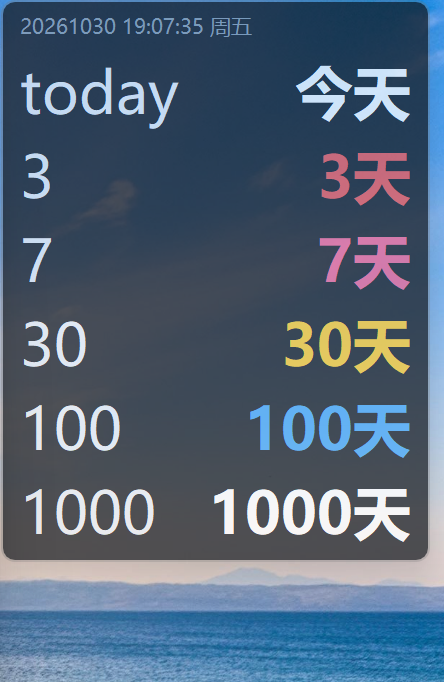
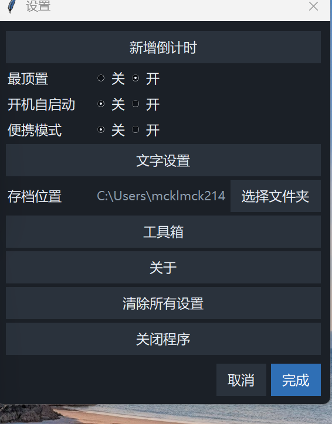
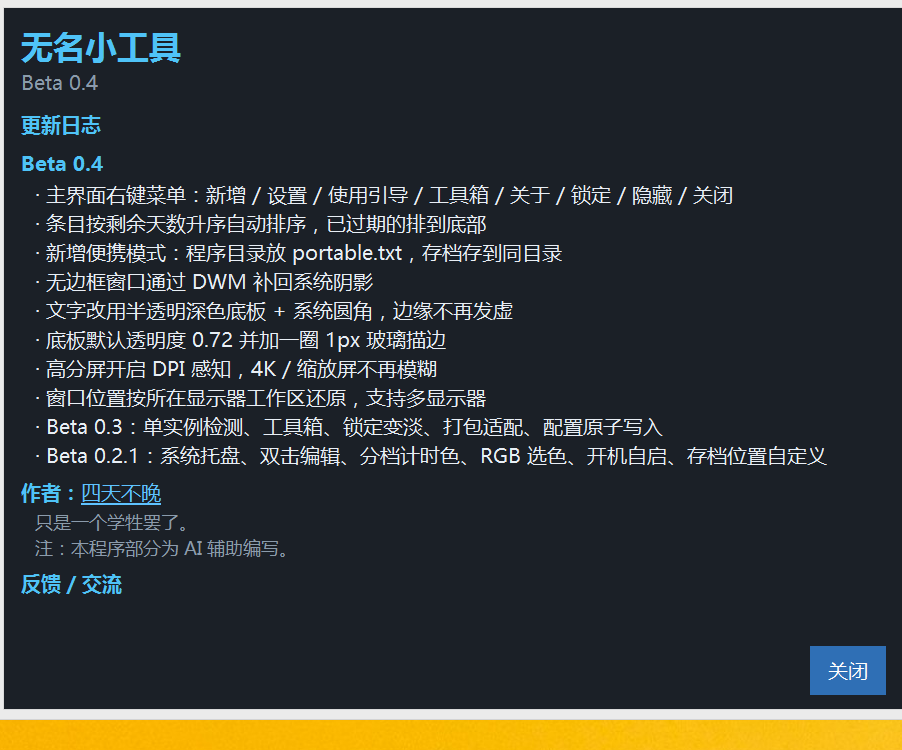
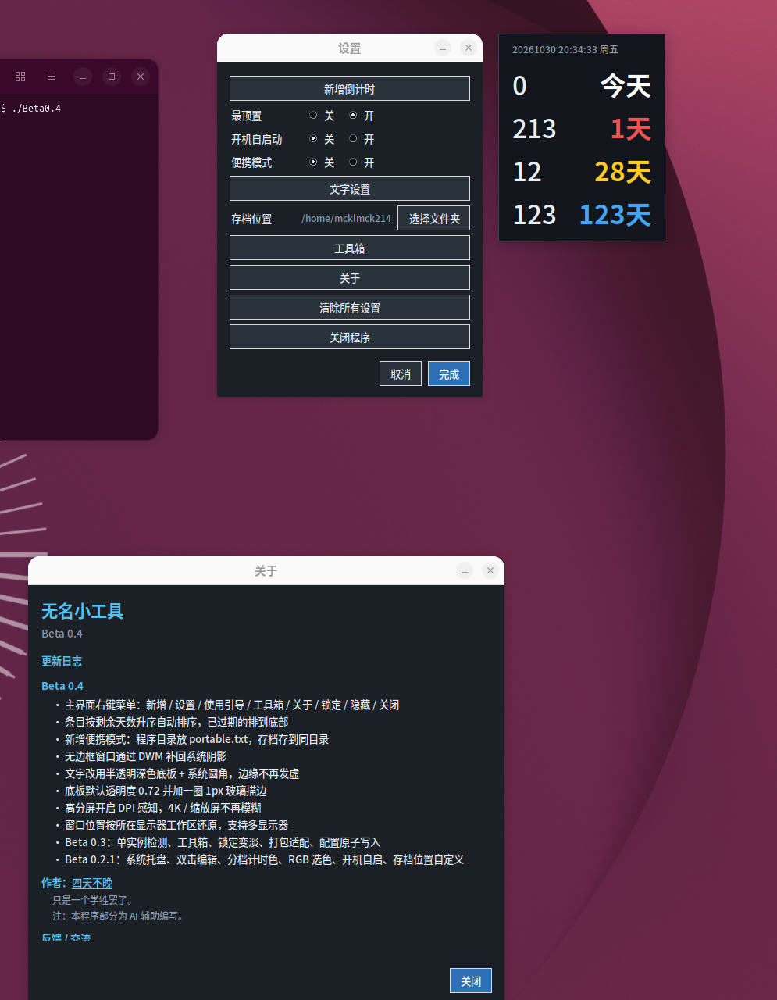
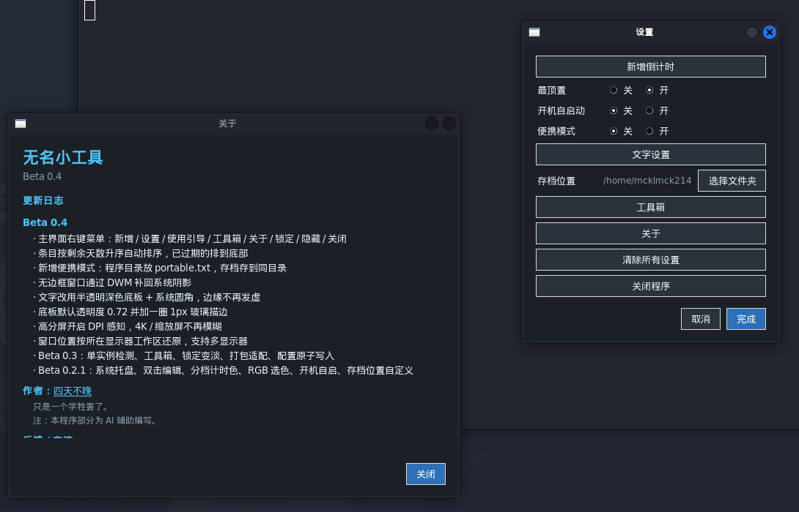
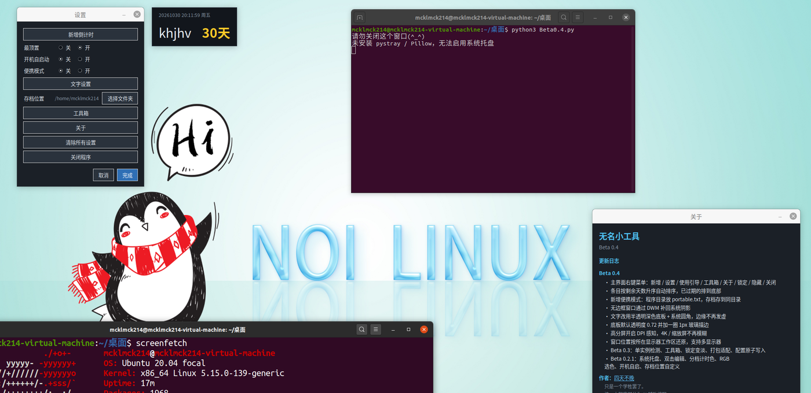

# 无名小工具（Desktop Countdown）

一个常驻桌面角落的透明倒计时小工具：一个无边框小窗，同时盯住多个「还有多少天」。

> 当前版本：**Beta 0.4**

## 功能

- **两种计时方式**
  - `n 天后`：每天自动顺延，适合「连续打卡」这类滚动目标
  - `指定日期`：固定倒数到某一天，过期后可一键删除
- **自动排序**：条目按剩余天数升序排列，已过期的沉到底部
- **分档计时色**：今天 / 3 天内 / 7 天内 / 30 天内 / 365 天内 / 1000 天内各用一种颜色，支持自定义
- **无边框悬浮窗**：半透明深色底板 + 系统阴影 + Windows 11 圆角，可拖动、可锁定
- **系统托盘**：隐藏 / 显示、锁定、设置、使用引导、工具箱、关于
- **右键菜单**：主页右键即可新增、设置、锁定、隐藏
- **双击编辑**：双击条目修改名称、时间、颜色
- **便携模式**：程序目录放一个 `portable.txt`，存档就写到程序目录，不碰用户主目录
- **工具箱**：一键启动同目录下的 `Plain Craft Launcher 2.exe` 与 `geek.exe`（后者自动提权）
- **单实例检测**：重复启动会提示并退出，不会出现两个窗口抢同一个存档
- **高分屏友好**：开启 DPI 感知，多显示器按各自工作区还原窗口位置

## 界面

### 主界面

六档剩余天数自动配色，条目按天数升序排列，过期条目沉到底部。



### 设置窗口

最顶置、开机自启动、便携模式、文字颜色与大小、存档位置、工具箱、关于。



### 托盘菜单

左键托盘图标显示 / 隐藏主界面，右键打开完整菜单。


### 工具箱

一键启动下载工具（Plain Craft Launcher）与卸载工具（Geek Uninstaller），后者自动 UAC 提权。


### 关于

内置更新日志、作者与反馈入口。



### Linux

Ubuntu 24.04（打包版，主界面六档配色 / 设置 / 关于）：



Kali Linux（打包版，Xfce 桌面，设置与关于窗口）：



NOI Linux（Ubuntu 20.04 内核，只能用 `python3 Beta0.4.py` 源码运行）：



Linux 下没有 `-transparentcolor` 抠底，窗口以半透明深色底板呈现；未安装 `pystray` / `Pillow` 时启动会提示「无法启用系统托盘」，其余功能正常。

## 系统兼容性

| 系统 | 状态 |
| --- | --- |
| Windows 11 | 已验证，支持系统圆角与 DWM 阴影 |
| Windows 10 | 已验证 |
| Windows 8.1 | 已验证 |
| Windows 7 / Vista | 不支持：单文件版缺少 Python 3.14 运行库依赖，启动报 `python314.dll` 加载失败 |
| Kali Linux | 已验证，使用打包版 `Beta0.4-linux-x86_64` |
| Ubuntu 24.04 | 已验证，使用打包版 |
| NOI Linux（Ubuntu 20.04） | 仅源码运行：打包版依赖较新的 glibc，请用 `python3 Beta0.4.py` |

## 运行

```bash
pip install pystray pillow
python Beta0.4.py
```

- 依赖 `tkinter`（标准库）、`pystray`、`Pillow`（托盘图标；缺失时自动降级为快捷键操作）
- 启动后不会出现任务栏图标，一切从**系统托盘**开始；托盘不可见时按 `Ctrl+Shift+L` 切换锁定
- Linux 打包版：从 Releases 下载 `Beta0.4-linux-x86_64`，`chmod +x` 后直接运行（Kali / Ubuntu 24.04 已验证）

## 文件结构

```
Beta0.4.py     主程序：窗口、菜单、对话框、托盘、单实例
utils.py       通用工具：路径、日期、DPI、DWM 阴影/圆角、多屏工作区、开机自启
storage.py     配置读写：存档路径、原子写入、便携模式
image.png      托盘图标
OLD_FILES/     历史版本源码与打包产物（仅存档，不参与运行）
```

## 存档位置

- 默认：`%USERPROFILE%\.desktop_countdown.json`（配置文件），`~/.desktop_countdown_dir.json` 记录自定义存档目录
- 便携模式：程序目录下存在 `portable.txt` 时，配置写到程序目录
- 所有写入使用「临时文件 + 原子替换」，异常退出不会损坏存档

## 版本记录

| 版本 | 主要内容 |
| --- | --- |
| Beta 0.4 | 右键菜单、自动排序、拆出 utils/storage、便携模式、DPI 感知、多显示器、DWM 阴影与圆角、深色半透明底板 |
| Beta 0.3 | 单实例检测、工具箱、锁定变淡、打包路径适配、配置原子写入 |
| Beta 0.2.1 | 系统托盘、双击编辑、分档计时色、RGB 选色、开机自启、存档位置自定义 |
| Beta 0.1 / Alpha 0.0.1 | 初版：透明窗口、新增/编辑倒计时、分档颜色 |

## 作者

- B 站：<https://space.bilibili.com/2061499488>
- 邮箱：<mcklmck214@outlook.com>
- 爱发电：<https://ifdian.net/a/wmxgj>

## 反馈与交流（QQ 群）

| 群 | 群号 | 加群链接 |
| --- | --- | --- |
| 无名小工具反馈群 | 823223052 | <https://qm.qq.com/q/livvSfQFfG> |
| 无名小工具交流群 | 684287871 | <https://qm.qq.com/q/1Q95hMYAxG> |
| 无名小工具征集群 | 136476657 | <https://qm.qq.com/q/twudn725CU> |

> 注：本程序部分为 AI 辅助编写。
